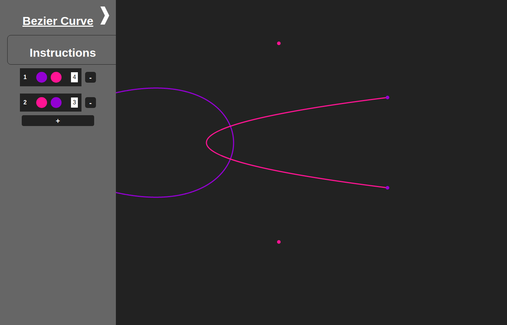
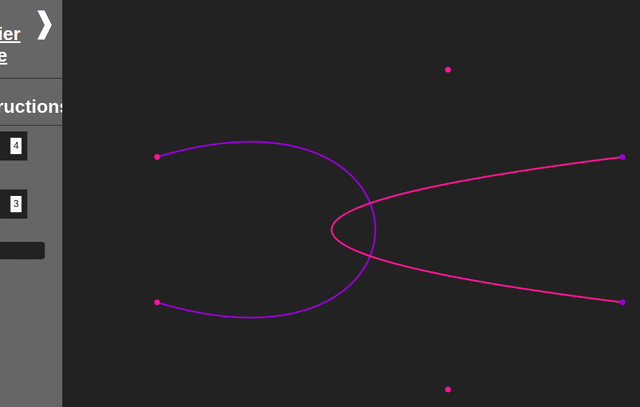

# Bezier curve playground

An interactive tool to draw Bezier curves in the browser. You place control points, and the page draws the curve through them. It is my first JavaScript project, from 2023.

## What it does

- Draws Bezier curves of any order: 4 points give a cubic curve, 3 points a quadratic curve, and so on.
- Keeps several groups of points. Each group is one curve with its own colours.
- Lets you add, move and delete points with the mouse.
- Can hide the points or the curves, so you can see the art alone.

## How it works

The curve is the Bernstein form of a Bezier curve. For control points P0 ... Pn, each point on the curve is:

    B(t) = sum over i of  C(n, i) * t^i * (1 - t)^(n - i) * Pi      for t from 0 to 1

The code computes the binomial coefficients C(n, i) once per curve. Then it steps t from 0 to 1 in steps of 0.001, sums the weighted points, and joins the results with a line on a 2D canvas. It does not use de Casteljau's algorithm. The curve is redrawn after every change.

The main code is in `code/functions/multigroup_of_bezier_curve.js`. The first version, with one group, is in `code/functions/1_group_of_bezier_curve.js`.

## Run

Open `index.html` in a browser. No build step is needed. To serve it locally, run `python -m http.server` in this folder.

## Instructions

## Deleting Existing Points

To remove a point, simply double-click on it.

## Hiding/Showing Points and Curves

- To hide/show all points, press Shift + H + P.
- For hiding/showing curves, press Shift + H + C.

## Adding Points

1. Select a group by clicking on it.
2. To add a new point, double-click on an empty area of the canvas while the group is selected.

## Moving Points

Click and hold the mouse button on a point, then drag the mouse to relocate the point.

## Toggling Hidden Column

Hold the Ctrl key to toggle the visibility of the hidden column.

*P.S. Note that this feature may have some issues for which we apologize for any inconvenience caused.*

## Group Operations

- Creating a New Group: Click on the [+] button located below the existing groups to create a new group.
- Deleting a Group: To delete a group, click on the [-] button positioned on the right side of the group block.
- Selecting All Groups: Press Shift + A to select all groups.
- Deselecting All Groups: Press Shift + A + C to deselect all groups.

## Changing Color

To modify the color of a curve or points within a group:

- Select the desired group.
- Utilize the color button provided in the group block to change the color.

## Status

A finished study project. I do not plan new features.

## License

MIT, see `LICENSE`.

Part of my portfolio: https://ilyaeis.github.io
